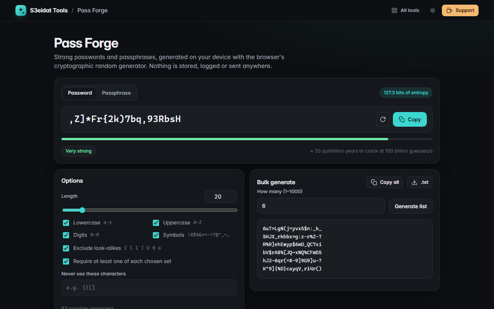

# Pass Forge

> Strong passwords and passphrases, generated on your device. Free, private, and it runs entirely in your browser.

### ▶ [Open Pass Forge](https://s3eidat.github.io/pass-forge/)



## Features

- **Passwords** from 8 to 128 characters: lowercase, uppercase, digits and symbols (`!#$%&*+-=?@^_~()[]{}<>.,:;/|`)
- **Exclude look-alikes** (`I l 1 | O 0 o`) and any characters you list yourself
- **Require each set**: at least one character from every set you picked
- **Passphrases** from a built-in list of 2,381 common English words (about 11.2 bits per word): 3–12 words,
  hyphen / space / dot / underscore / no separator, optional capitals and an optional number
- **Entropy in bits**, a strength label and the time to crack at 100 billion guesses per second
- **Bulk generate** up to 1,000 at once, copy all or download as `.txt`
- Press <kbd>R</kbd> for a new one; click the result to copy it

## How the randomness works

- Every character, word and number comes from `crypto.getRandomValues` (the browser's CSPRNG).
- Picking an index in `[0, n)` uses **rejection sampling**: 32-bit values at or above
  `floor(2^32 / n) * n` are thrown away, so `x % n` has no modulo bias.
- "Require each set" regenerates the whole password until the rule holds. That keeps every valid password
  equally likely, and the entropy shown is the exact count of valid passwords, computed by inclusion–exclusion
  (`log2` of that count), not the usual `length × log2(pool)` overestimate.
- Passphrase entropy is `words × log2(2381)`, plus `log2(100) + log2(words)` when a number is added.
  Capitalizing every word adds nothing, so it isn't counted.
- The built-in self-test checks the rejection-sampling boundary, the entropy maths against known values, and that
  excluded characters never appear across hundreds of generated passwords.

## Privacy

Generated passwords are never saved, logged or sent. Only your option choices (length, sets, separator)
are remembered in this browser's local storage. There is no server, no account, no analytics.
The page ships with a strict Content-Security-Policy (`connect-src 'self'`), so the browser
itself blocks any attempt to send data anywhere.

## Run it yourself

It's plain HTML, CSS and JavaScript with no build step:

```bash
git clone https://github.com/s3eidat/pass-forge
cd pass-forge
python -m http.server 8000
```

Then open http://localhost:8000.

## Support

If this saved you time, **[buy me a coffee ☕](https://s3eidat.github.io/coffee/)**. It keeps every tool free.

---

Part of **[S3eidat Tools](https://s3eidat.github.io/)**: 100+ free, private tools that run in your browser. MIT licensed.
